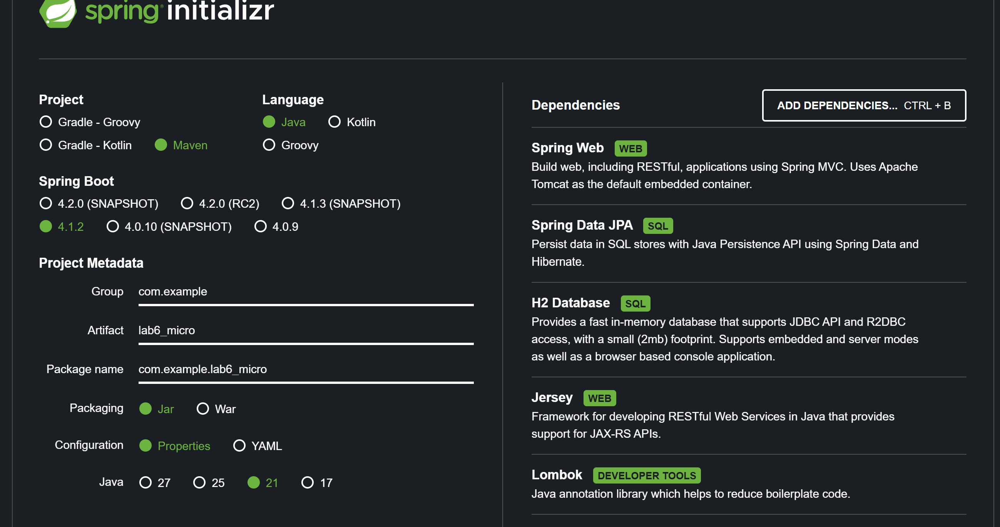
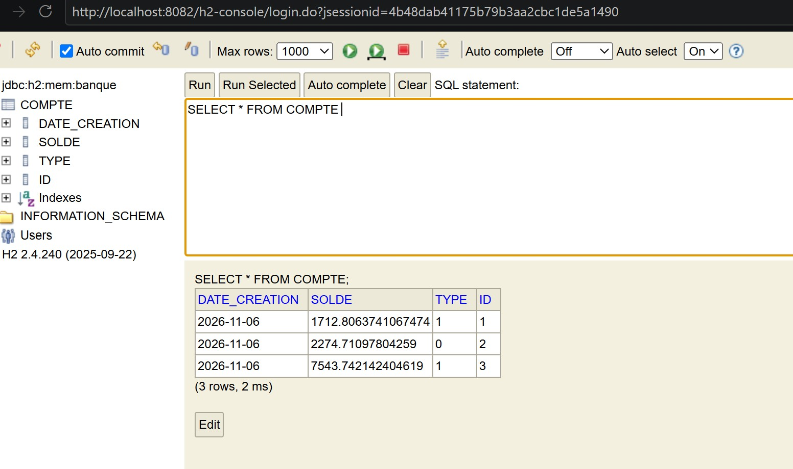

# Lab6 Micro

Application Spring Boot de gestion de comptes bancaires avec Jersey, JPA et H2.

## Captures d’écran

Configuration du projet avec Spring Initializr.

La console H2 affiche les trois comptes créés au démarrage.

